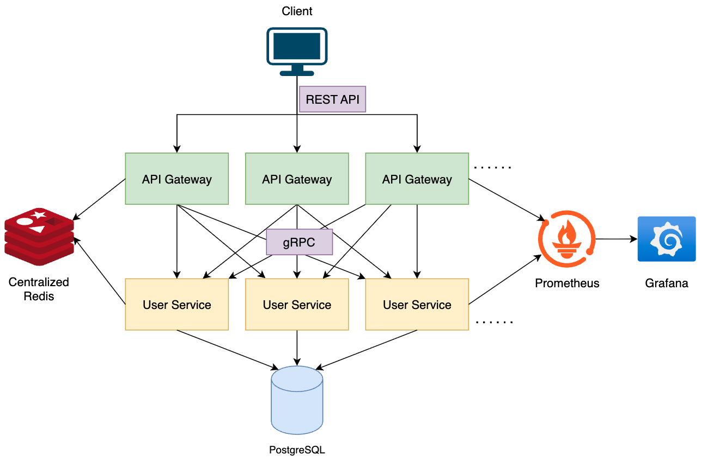

# Authify

Authify is a production-ready authentication and authorization microservice designed for modern, scalable applications.

# Table of Contents

- [Authify](#authify)
- [Table of Contents](#table-of-contents)
- [System Architecture](#system-architecture)
  - [High Level](#high-level)
- [Project Setup](#project-setup)
  - [Frontend](#frontend)
  - [AWS Deployment](#aws-deployment)
  - [k6 Load Testing](#k6-load-testing)

# System Architecture

## High Level

<p align="center">
  
</p>

# Project Setup

Choose an environment and follow its setup guide:

- [Run the services on localhost](docs/setup/localhost.md)
- [Run the services with Docker Compose](docs/setup/docker.md)
- [Run the services on Kubernetes with Kind](docs/setup/k8s-kind.md)

The guides use Make targets from the repository root.

## Frontend

The [React frontend](frontend/README.md) uses TypeScript, Vite, and Material UI. It provides email/password login and a protected home page displaying the user's database profile.

Start the backend using a setup guide above, then run:

```sh
npm --prefix frontend ci
npm --prefix frontend run dev
```

Open `http://localhost:3000`.

## AWS Deployment

Choose an AWS deployment guide:

- [Amazon EC2 with AWS CLI](docs/setup/aws/aws-ec2/deployment.md)
- [Amazon EC2 with Terraform](docs/setup/aws/ec2-terraform.md)
- [AWS Elastic Beanstalk](docs/setup/aws/aws-elastic-beanstalk/deployment.md)

## k6 Load Testing

Run the login load test against localhost, Docker Compose, or Kind with the [k6 load testing guide](docs/k6-load-test.md). The default scenario sends 200 concurrent requests for each of five unique test accounts.
