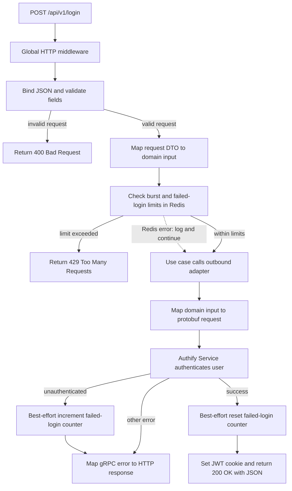
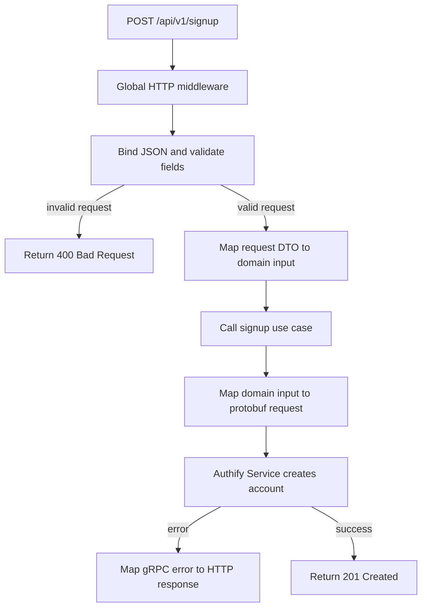
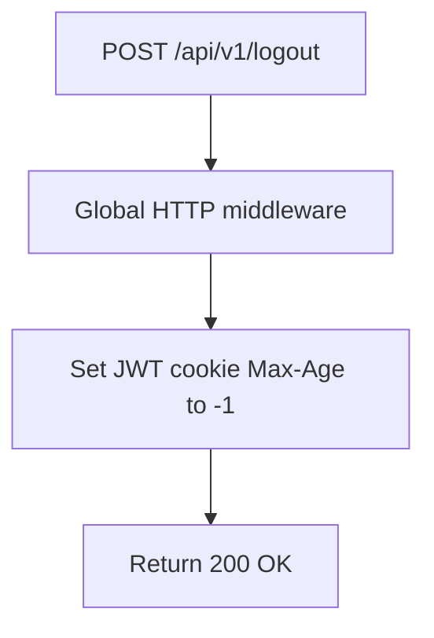
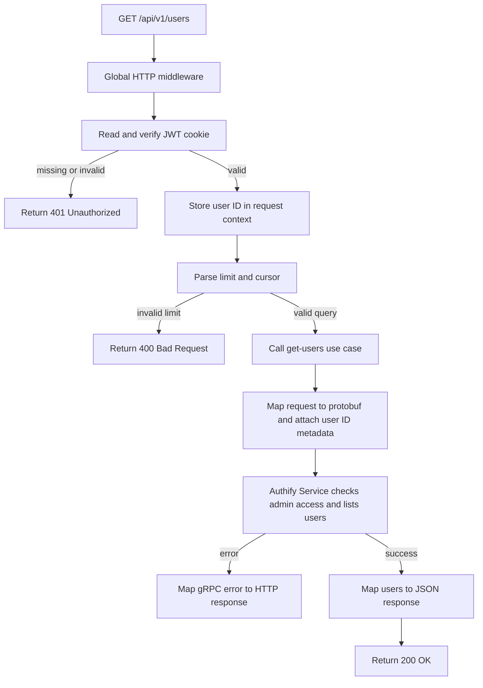
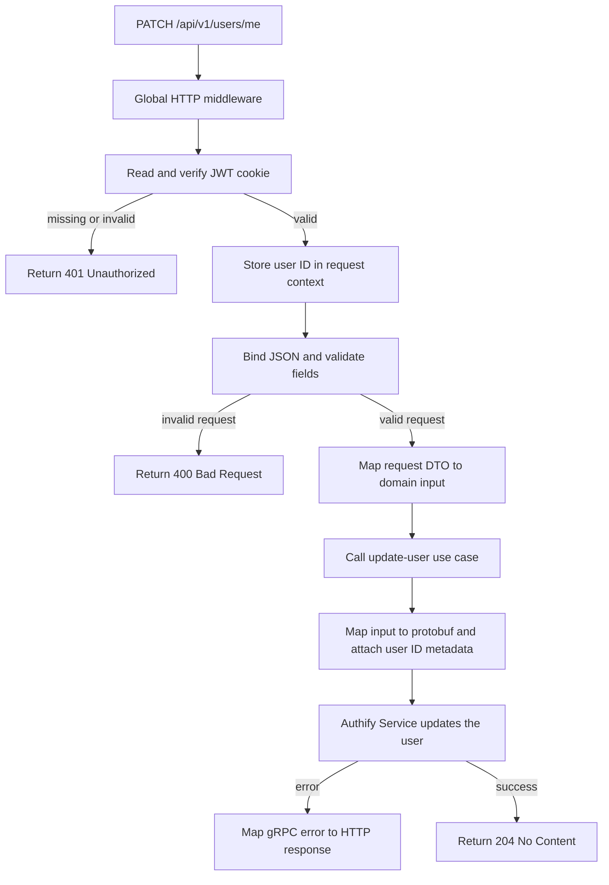

# API Gateway

The API Gateway exposes REST endpoints and forwards user operations to Authify Service over gRPC. It also handles HTTP request validation, JWT cookies, login rate limiting, and readiness checks.

## API Endpoints

| Method | Endpoint | Description |
|:---:|:---|:---|
| GET | `/health/liveness` | Confirms that the gateway process is running. |
| GET | `/health/readiness` | Checks whether Redis is reachable. |
| GET | `/metrics` | Exposes Prometheus metrics. |
| POST | `/api/v1/login` | Authenticates a user and sets the JWT cookie. |
| POST | `/api/v1/signup` | Creates a user account. |
| POST | `/api/v1/logout` | Expires the JWT cookie in the browser. |
| GET | `/api/v1/users` | Lists users. Requires a valid JWT cookie and an administrator account. |
| PATCH | `/api/v1/users/me` | Updates the authenticated user's supported fields. Requires a valid JWT cookie. |

All requests pass through the gateway's global request logging, panic recovery, and HTTP metrics middleware. The diagrams below focus on each endpoint's main flow.

## Endpoint Flows

### `POST /api/v1/login`

Login validates the JSON request, applies burst and failed-login limits using Redis, then calls Authify Service over gRPC. On success, the gateway sets the JWT cookie and returns the user response.

### `POST /api/v1/signup`

Signup validates the JSON request and forwards the account creation operation to Authify Service. This endpoint does not currently use the login rate limiter.

### `POST /api/v1/logout`

Logout does not require JWT verification and does not call Authify Service. It expires the browser's cookie.

### `GET /api/v1/users`

The authentication middleware verifies the JWT cookie before the handler runs. The authenticated user ID is passed to Authify Service as gRPC metadata, where the service checks administrator access and returns a page of users.

### `PATCH /api/v1/users/me`

The authentication middleware verifies the JWT cookie. The gateway validates the update body and forwards the update with the authenticated user ID in gRPC metadata.

